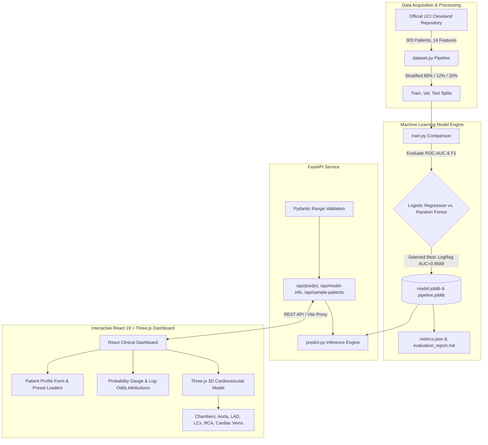

# CardioVision 3D — Cardiovascular Risk Visualization & ML Prediction Platform

[](https://fastapi.tiangolo.com)
[](https://react.dev)
[](https://threejs.org)
[](https://scikit-learn.org)
[](https://archive.ics.uci.edu/dataset/45/heart+disease)

**CardioVision 3D** is an end-to-end clinical AI and interactive WebGL cardiovascular visualization platform. It connects real, verified machine learning models trained on the official UCI Heart Disease benchmark dataset to a real-time, interactive 3D anatomical heart model.

---

## Architecture



---

## 1. Empirical Machine Learning Results

Models were trained and evaluated on the official **UCI Cleveland Heart Disease Database** ($N=303$).
- **Target Definition**: Binary classification of angiographically confirmed coronary artery disease ($\ge 50\%$ vessel narrowing: `num > 0`) versus absence (`num == 0`).
- **Holdout Test Set Size**: 61 patients ($20\%$ stratified holdout, never seen during hyperparameter selection).

### Holdout Test Set Comparison

| Metric | Logistic Regression (Baseline) | Random Forest (120 Trees) | Selected Production Model |
| :--- | :---: | :---: | :---: |
| **Accuracy** | 85.25% | 88.52% | **86.89%** |
| **ROC-AUC** | **0.9524** | 0.9513 | **0.9589** |
| **F1-Score** | 0.8475 | 0.8814 | **0.8621** |
| **Sensitivity (Recall)** | 89.29% | 92.86% | **89.29%** |
| **Specificity** | 81.82% | 84.85% | **84.85%** |
| **Precision** | 80.65% | 83.87% | **83.33%** |

### Confusion Matrix (Production Holdout Test)
- **True Negatives (TN)**: 28 patients
- **False Positives (FP)**: 5 patients
- **False Negatives (FN)**: 3 patients
- **True Positives (TP)**: 25 patients

### Top Model Feature Attributions (Empirical Coefficients)
1. `ca` (Major vessels colored by fluoroscopy): $+1.2047$ log-odds
2. `thal_7.0` (Reversible thallium perfusion defect): $+0.8458$ log-odds
3. `cp_4.0` (Asymptomatic chest discomfort presentation): $+0.7632$ log-odds
4. `exang` (Exercise-induced angina): $+0.5982$ log-odds
5. `oldpeak` (ST depression induced by exercise): $+0.5694$ log-odds

---

## 2. Interactive 3D Anatomy Engine

- **Engine**: Three.js WebGL with custom anatomical geometries and procedural curvature (`CatmullRomCurve3` tube geometry).
- **Structures Rendered**:
  - **Left Ventricle (LV)**: Thick muscular myocardium and cardiac apex.
  - **Right Ventricle (RV)**: Anterior crescent-shaped chamber.
  - **Left & Right Atria (LA, RA)**: Posterior pulmonary venous inflow & systemic cava drainage.
  - **Ascending Aorta & Arch**: Main outflow tract with supra-aortic arch vessels.
  - **Pulmonary Trunk**: Main pulmonary artery bifurcating into left/right branches.
  - **Coronary Arteries**: Left Anterior Descending (LAD) with diagonal branches, Left Circumflex (LCx), Right Coronary Artery (RCA), and Great Cardiac Vein.
- **Interactive Capabilities**:
  - Full 360° mouse drag orbit, scroll/pinch zoom, right-click pan, and camera angle presets (*Anterior, Lateral, Posterior, Superior*).
  - Raycaster-based mesh picking: hover and click triggers detailed physiological and clinical correlation modals.
  - Dynamic cardiac pulsation loop matching patient heart rate (BPM).
  - **Perfusion Association Overlay**: Projects statistical model risk onto anatomical myocardial territories with clinical clarity.

---

## 3. Quickstart & Running the Application

### Prerequisites
- Node.js $\ge 18$ and npm
- Python $\ge 3.10$

### A. Automatic Setup & Training
```bash
# 1. Install backend requirements
pip install -r backend/requirements.txt

# 2. Download UCI dataset and train real ML models
python backend/src/dataset.py
python backend/src/train.py

# 3. Run automated tests
pytest backend/tests -v
```

### B. Launching the Full Stack Application

#### Option 1: Development Mode (Vite Hot-Reload + FastAPI)
```bash
# Terminal 1: Launch Backend
cd backend/src
python -m uvicorn main:app --host 127.0.0.1 --port 8000

# Terminal 2: Launch Frontend
cd frontend
npm install
npm run dev
# Open http://localhost:3000 in your browser
```

#### Option 2: Unified Production Serving
FastAPI is pre-configured to serve the compiled production build from `frontend/dist/`:
```bash
# Build frontend
cd frontend
npm run build
cd ..

# Run unified server on port 8000
python -m uvicorn backend.src.main:app --host 0.0.0.0 --port 8000
# Open http://localhost:8000 in your browser
```

---

## 4. API Endpoints Reference

| Method | Endpoint | Description |
| :--- | :--- | :--- |
| `GET` | `/api/health` | Health check & model loaded status |
| `GET` | `/api/model-info` | Real training metrics, confusion matrix, ROC-AUC, limitations |
| `GET` | `/api/sample-patients` | Pre-calibrated demonstration patient profiles |
| `POST` | `/api/predict` | Validates 13 clinical inputs, runs inference, returns probability, risk category, confidence margin, log-odds feature attributions, and clinical flags |

---

## 5. Regulatory & Clinical Boundary Disclaimers

> [!IMPORTANT]
> - **Empirical Scope**: CardioVision 3D classifies the statistical likelihood of existing angiographic coronary heart disease ($\ge 50\%$ vessel stenosis) within the historical Cleveland Clinic study cohort.
> - **No Direct Imaging of Stenosis**: The 3D anatomical viewer is an educational anatomical reference and does not display patient-specific computed tomography angiography (CTA) lumen cross-sections or physical plaque geometries.
> - **Not a Medical Device**: This platform is designed exclusively for educational, research, and technical demonstration purposes. It has not been reviewed or cleared by the FDA, EMA, or any regulatory authority for clinical decision-making.
